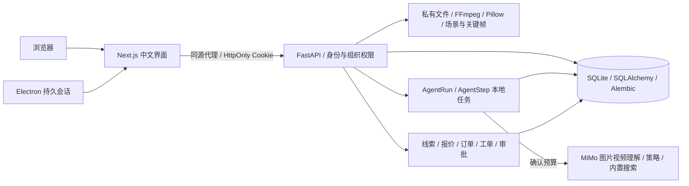
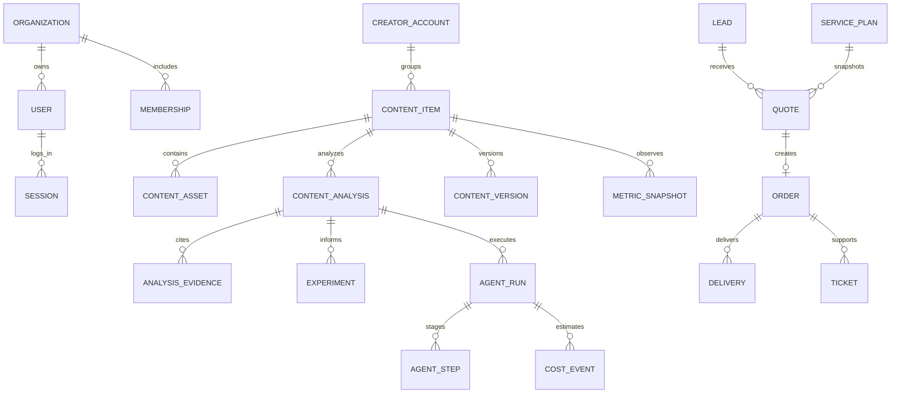
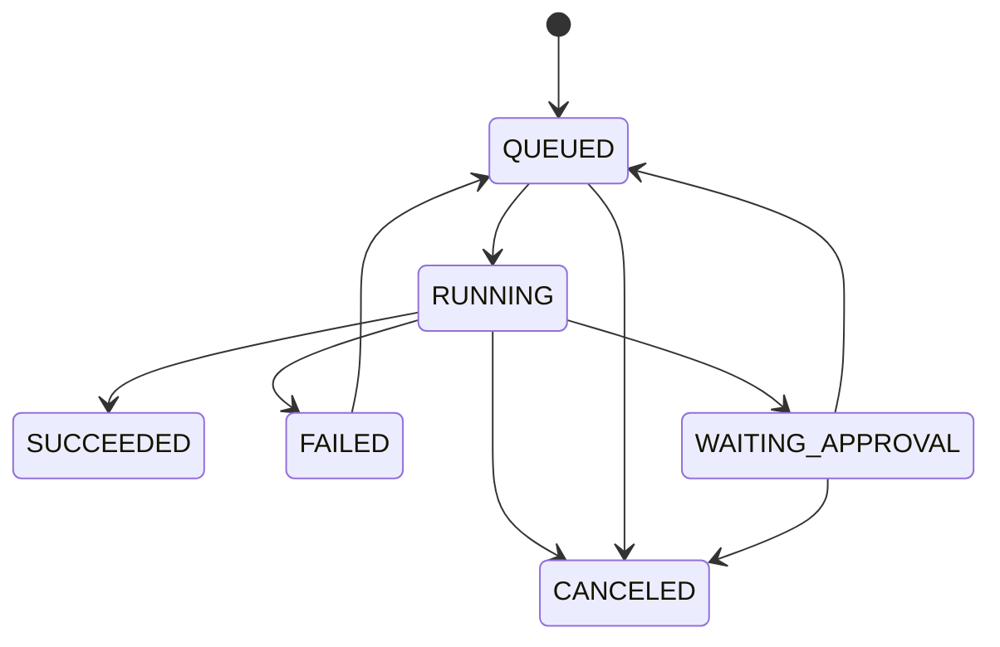

# CreatorOS v1 架构与数据关系

当前阶段说明见 [项目说明书](PROJECT_GUIDE.md)。历史验收记录保留在 TEST_REPORT.md。

## 身份与边界

每次研究查询限定工作区；商务记录通过明确的客户用户／组织 ID 关联，老板操作还需 OWNER_ADMIN。密码使用 Argon2，数据库仅存会话令牌摘要。记住登录使用 30 天持久 Cookie；退出撤销记录并清除 Cookie。桌面继续使用固定配置目录，登录变化与退出前及时写盘。

原始文件保留随机私有路径，展示和下载名使用作品标题。图片类型使用明确扩展名映射，兼容 Windows WebP 注册表差异。封面和头像通过授权接口读取，表格链接不会由后端任意抓取。

## 数据关系

跨角色客户关联以及部分可选研究字段保存在实体的 `data` JSON 中，由服务层校验，不能只依赖 ER 图推断访问权限。Approval 记录决策和目标快照，AuditLog 记录业务操作。PaymentRecord 保留兼容旧记录，不代表当前已接入支付网关。

## 工作流

COO、内容、数据、检索、策略、质检、商务依次交接结构化数据。AI 模式下内容理解、联网核查和创作策略可能产生外部费用；其他阶段由本地规则和数据库处理。成功节点持久保存，重试跳过成功节点；启动恢复不会自动重放付费请求。

## 订单口径

真实客户确认的订单先进入 REQUESTED，老板接单后 IN_PROGRESS 并记录 accepted_at，交付后 DELIVERED，客户验收后 COMPLETED。报价订单先等待客户确认。经营金额按接单记录计算，旧模拟业务排除；尚未接入真实资金支付。

系统适合当前单机结构，本地工作线程不是分布式队列。公网、生产数据库和多实例执行需按 OWNER_ACTIONS.md 补充部署与运行保障。
