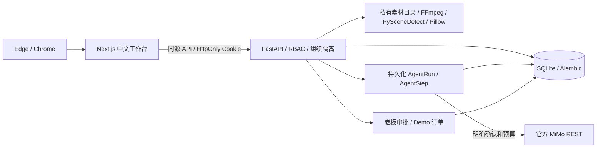
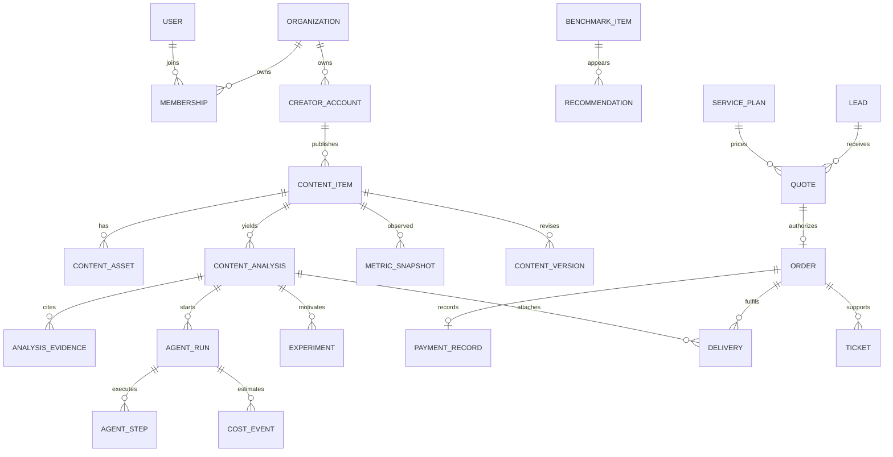
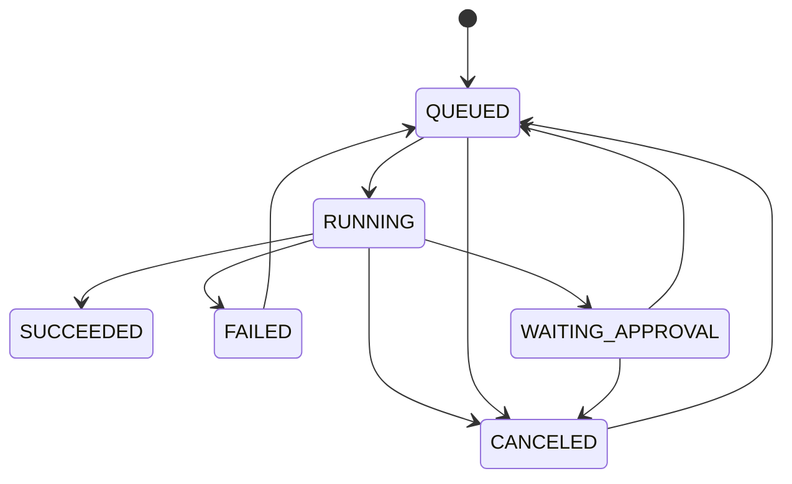

# CreatorOS 架构

会话令牌随机生成，数据库仅存 SHA-256 摘要，密码使用 Argon2。API 查询通过用户工作区限定。客户线索由登录会话绑定身份，老板审批后创建跨角色可见订单，客户只可验收关联订单。素材文件通过授权 API 读取，数据库保留原文件名和随机私有存储路径。对标链接仅保存与显示，服务端不抓取任意 URL。

`Approval` 记录审批种类、目标 ID、审查意见及状态。`AuditLog` 保存操作者、动作和时间。报价、订单和支付有独立实体及状态。模拟金额只进入 Demo 统计。

COO 建立任务和预算，依次交接给内容拆解、数据分析、对标检索、创作策略、报告质检和商务运营。步骤使用结构化输入输出。历史步骤和结果按工作区持久化，重试从失败步骤继续。后台任务为单机实现，服务重启会标记中断，需重新发起。外部调用取消是协作式，已发送的请求仍可能产生费用。
