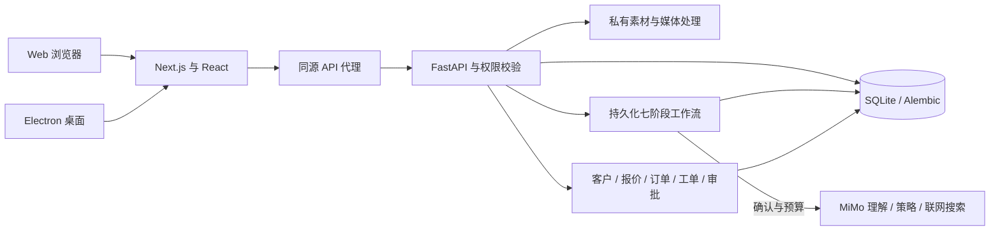

# CreatorOS v1 项目说明书

版本：v1.0.0 · 阶段交付日期：2026-11-08 · 项目：CreatorOS · 爆款实验室。

## 1. 项目定位

CreatorOS 为创作者提供可积累的内容研究工作区，并将创作服务的客户、报价、订单和交付放在同一系统中管理。目标是让内容观察、数据依据、改进版本和后续实验互相关联，帮助用户复盘每一次创作。

当前面向 Windows 本机使用。浏览器和 Electron 桌面窗口使用同一套 Web/API 与 SQLite；通过组织及用户身份隔离资料。GitHub 交付源码及重建环境所需文件，不包含当前电脑的账号数据库或客户材料。

## 2. 用户与工作区

### 创作者／客户

自行注册后获得独立工作区，可以上传作品、运行分析、管理账号和对标资料、导入指标、保存版本与实验、提交需求、确认订单和查看客服回复。

### 老板管理员

由初始化命令生成，使用相同登录入口。可进入公司总览、客户与线索、服务与报价、订单与交付、人工审批、工单、经营报表及 Agent 监控。权限由服务端检查，隐藏菜单本身不作为权限控制。

### 登录记忆

登录及注册默认勾选“记住登录（30天）”，客户端保存 HttpOnly 会话 Cookie，服务器保存随机会话令牌的哈希。桌面端在登录、退出及正常关闭时及时保存 Cookie。取消勾选时使用不跨正常关闭保留的会话 Cookie；主动退出立即撤销会话。已有旧会话不自动延长，首次启用需本人登录一次，程序不保存明文密码。

## 3. 功能与操作

### 3.1 新建内容分析

1. 在“内容分析”中选择图片、视频、图集、文稿或字幕。
2. 填写作品标题、平台、内容类别、关联账号、作者和发布日期等背景。支持输入及常用选项，同一工作区内新作品标题不能重复。
3. 检查预览和文稿。作品标题用作后续素材、历史记录及审批的可读标识。
4. 选择本地基础分析，或配置 MiMo 后选择深度分析、预算并确认发送所需材料。
5. 查看七阶段进度，报告生成后编辑标题及脚本、保存新版本，按需导出 Markdown/JSON。

默认素材限制：单次 100 MB、最多 12 个文件、视频不超过 10 分钟和 4K。支持 MP4/MOV、JPG/PNG/WebP、TXT/MD/SRT/VTT。服务端检查扩展名、解码及尺寸，文件通过登录授权接口读取。

素材卡片显示真实图片和视频，右上角可打开页面内放大预览。视频播放仍依赖浏览器支持相应编码。

### 3.2 本地分析与 MiMo

本地模式执行确定性结构检查、媒体解析和基础建议，不声称理解视频语义。MiMo 模式将实际图片或可容纳的视频发送至已配置模型；大图在请求内适配尺寸，较大视频使用真实关键帧及时间码，原文件保留。口播信息可通过字幕或文稿补充，未启用自动转录。

联网核查使用 MiMo 的内置搜索，需账号开通联网服务插件。核查公开事件、时间和数字等事实，只有服务返回的来源可用于标为查证。报告集中显示查到的偏差和缺少依据的待审阅项，不以作者身份真实性作为创作判断要求。

标题、开头和完整创作脚本是可编辑建议。来源约束和结构检查不等同于事实正确性保证，发布前仍应审阅。

### 3.3 分析历史和创作实验

分析历史支持折叠、滚动、备注、分享及删除入口。历史删除使用受保护的隐藏标记，不等同于物理删除原始素材；运行中或已交付的报告受额外保护。分享通过既有报告入口进行，访问仍受工作区权限约束。

在报告的“下一步修改清单”选择一条建议并创建关联实验，系统保存：

- 关联作品、报告及作品版本快照。
- 待验证假设和所选修改。
- 目标指标与观测窗口。

重复点击复用同一建议生成的实验。成功后可跳转并定位实验，在后续创作中补充发布、指标或观察结果。实验复盘区分变化与因果，单次增长不直接归因于某条建议。

### 3.4 创作者档案

维护账号名称、平台、领域、人设、受众、内容风格及头像。平台可选常用项，选择“其他”时备注实际平台。头像经过图片格式和尺寸处理。账号档案可关联作品和指标，用于持续积累研究背景。

### 3.5 对标作品库

手工录入或通过 CSV/XLSX 导入真实作品及其来源、平台、作者、类别、标签和指标。可随表格导入匹配的封面图片，支持检索、平台／类别筛选、排序、收藏、详情和删除。无来源或无指标的条目不会被补造链接或表现数值。

本地检索以已有授权资料为依据，词项相似度与相对表现分开显示。Demo 样本需要用户显式添加，并保留 Demo 标识。

### 3.6 指标与数据洞察

CSV/XLSX 导入支持预览、表头映射、作品匹配、文件指纹去重、快照和导入批次管理。缺失数值保持为空，不补零。趋势、排行、类别比较及互动率使用数据库中已导入的指标，展示相应来源和计算口径。

原始导出表留在本机。项目不自动登录或抓取用户的社交平台账号。

### 3.7 客户需求、工单与回复

客户登录后从首页提交需求或选择服务。新需求使用登录身份关联，预留联系方式不能随意绑定为其他账号。兼容历史留资时按完整邮箱与当前用户进行受限关联。

老板在线索中记录的内部备注仅供内部查看；单独填写的客户回复显示在对应用户“服务与反馈”中。工单状态、处理记录和关联订单可供对应客户查看，页面通过定期及重新聚焦刷新同步。

### 3.8 报价、订单和交付

直接选服务的路径：客户确认下单 → REQUESTED → 老板接单 → IN_PROGRESS → 完成服务／交付报告 → DELIVERED → 客户确认验收 → COMPLETED。

定制报价路径：老板创建报价 → 人工审批 → 生成 AWAITING_CUSTOMER 订单 → 客户确认 → 进入同样的接单流程。

价格和服务内容来自后台配置，首页按价格从低到高展示，并在刷新、重新激活或定期更新时获取最新配置。订单保留当时快照，避免后续改价影响已确认订单。

客户验收前弹窗确认服务接收和相关规则；确认后记录验收时间和完成状态。工单可以关联订单，但工单本身不会生成订单。

### 3.9 经营统计

当前营业金额按真实注册客户确认并由老板接单的订单金额统计，接单动作幂等，不重复计入。**这表示接单记账，尚未通过支付网关实际收款。**

旧模拟业务已从当前经营列表和报表口径中排除。模型成本取已记录用量与可配置单价估算；毛利估算未覆盖所有人工、税费和经营成本。周报由业务记录计算，不捏造增长。

## 4. 安装、配置与运行

### 4.1 环境

推荐 Windows 10/11、Node.js 24 LTS、Python 3.12、Git 和 PowerShell。Python 最低 3.11；使用前端测试工具时需 Node 22.12+ 的 Node 22 或 Node 24。数据库默认 SQLite，无需 Docker。

在新目录中克隆后：

```powershell
Set-Location .\CreatorOS-v1
Set-ExecutionPolicy -Scope Process -ExecutionPolicy Bypass
.\scripts\setup.ps1
.\scripts\start.ps1
```

安装脚本创建项目虚拟环境、安装锁定依赖、复制配置模板、迁移数据库并初始化管理员。已有依赖时可用 `setup.ps1 -SkipInstall`，或通过 `-PythonPath` 指定 Python 解释器。

默认 Web 地址为 `http://127.0.0.1:3000`，API 为 `http://127.0.0.1:8000`，OpenAPI 在 `/docs`。启停脚本在 `data/processes.json` 记录进程及实际端口，端口占用时以启动输出为准。

### 4.2 本机配置

`.env.example` 是配置结构，`.env` 仅留在本机。主要项：

- `DATABASE_URL`：默认 SQLite，可配置 PostgreSQL 驱动地址。
- `API_PORT`、`WEB_PORT`、`WEB_ORIGIN`：本地服务端口与来源。
- `COOKIE_SECURE`：与部署协议配套；当前本机 HTTP 使用 false。
- `MIMO_API_KEY`、`MIMO_BASE_URL`：MiMo 服务端凭证和端点。
- `MIMO_MODEL_FAST`、`MIMO_MODEL_REASONING`：轻量理解与复杂策略模型。
- `MIMO_INPUT_PRICE_PER_MILLION`、`MIMO_OUTPUT_PRICE_PER_MILLION`、`MIMO_WEB_SEARCH_PRICE_PER_CALL`：费用估算参数。
- `MIMO_TIMEOUT_SECONDS`、`MAX_UPLOAD_MB`、`MAX_VIDEO_SECONDS`：请求及素材限制。

单任务预算通过界面设置，服务端最高 10 元。预算是调用前的保守估算控制，实际费用以模型供应商账单为准。

### 4.3 桌面应用

初始化并确认本地服务可运行后，执行 `scripts/install-desktop.ps1`，建立桌面与开始菜单入口。当前运行包复用本机工程、虚拟环境和依赖，不是独立跨电脑安装器。

桌面单实例运行，渲染端关闭 Node 集成并启用 sandbox、contextIsolation。关闭窗口不停止分析服务；停止后台服务使用 `scripts/stop.ps1`。详见 [桌面说明](DESKTOP.md)。

## 5. 工程架构



前端：Next.js App Router、React、TypeScript、Recharts、局部 CSS Module 与现有全局样式。桌面：Electron。后端：FastAPI、Pydantic、SQLAlchemy、Alembic。媒体：FFmpeg、Pillow、OpenCV、PySceneDetect。测试：pytest、Vitest、Node test runner，另有显式浏览器验收脚本。

任务使用本地工作线程和数据库持久化，适合当前单机结构。尚未实现分布式任务队列，部署时不应简单增加独立 Uvicorn worker 假定任务已分布式化。

## 6. 数据和权限

主要实体包括：Organization、User、Membership、Session、CreatorAccount、ContentItem、ContentAsset、ContentAnalysis、AnalysisEvidence、ContentVersion、MetricSnapshot、BenchmarkItem、Experiment、Lead、ServicePlan、Quote、Order、Delivery、Ticket、AgentRun、AgentStep、Approval、CostEvent 和 AuditLog。

研究数据通过 `organization_id` 限定；客户业务通过明确的用户／组织关联访问。外来 ID 在操作前校验归属，老板端额外检查角色。密码使用 Argon2，明文密码和原始会话令牌不写入业务序列化响应。

本机 `data/` 保存数据库、上传、封面、头像、桌面运行包、日志和测试资料，不上传到 GitHub。`web_data/` 保存对标作品库、素材样例与导出包等模拟演示资料（全部为模拟数据，不含真实客户材料），随仓库提供。配置密钥和凭证不上传到 GitHub。仓库中的 `fixtures/` 是明确标记的测试样例。

## 7. 任务与费用

阶段依次为 COO、content、data、retrieval、strategy、quality、business。进度、重试、模型、输入输出摘要、费用与错误持久保存；运行时旋转提示，成功后绿色对号。

失败从失败节点重试，保留成功结果；取消阻止后续阶段，已发出的请求仍可能计费。服务重启会把中断任务标记为失败，等待用户明确重试，不静默恢复付费请求。缓存减少重复调用，联网未完成的报告可重新核查。

重大合规问题进入人工审批；模型不能直接发布、收付款或执行数据删除。详细模型调用边界见 [AI_NOTES](AI_NOTES.md)。

## 8. 备份与维护

- 数据库运行时使用 SQLite 一致性备份接口；或停止服务后复制数据库与 `data/uploads` 等素材目录。不要只复制运行中的数据库主文件并忽略 WAL。
- 将 `.env` 和本机账号凭证单独妥善保管，不提交版本库。
- 恢复前保留当前副本，确认数据库与素材对应，再运行迁移。
- 模型故障查看任务错误、估算费用和 `data/logs`，不要在未知请求结果下盲目重复付费调用。
- 更换电脑需重新安装依赖和建立桌面入口；当前 GitHub 仓库不会恢复旧电脑的业务记录。

## 9. 检查与交付范围

检查命令、实际结果和历史浏览器记录见 [TEST_REPORT](TEST_REPORT.md)。v1 交付覆盖本阶段源码、静态界面资源、依赖锁、数据库迁移、Windows 脚本、说明书和测试；不打包当前客户资料或账号凭证。

尚待外部接入或后续开发的事项：真实资金收付及对账、外部账号发布、自动语音转录、公网部署、跨电脑签名安装器、生产 PostgreSQL 数据迁移及分布式任务执行。操作依赖见 [OWNER_ACTIONS](OWNER_ACTIONS.md)。
